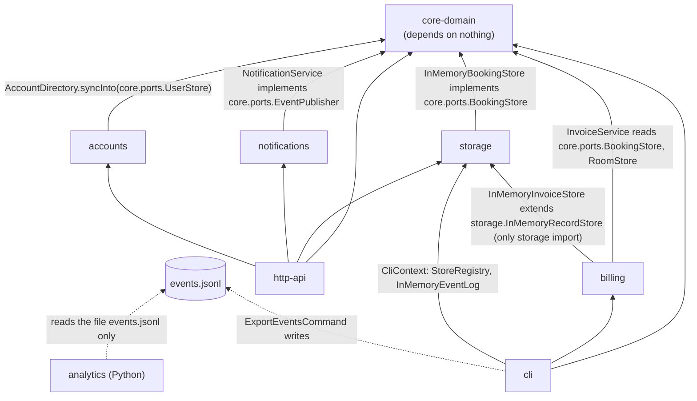
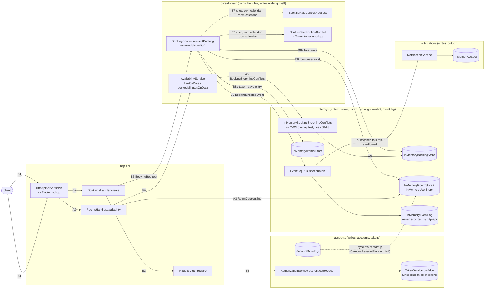

# BOUNDARIES.md

One section per milestone. Fill them in in order (the sketch before you write
anything about it, the copies next, the proposal last).

Draw Milestone 1's sketch from the code. A TA may ask where each arrow came
from.

Keep it short and specific. Point at modules, files, and callers.

---

## Milestone 1: The architecture as built

### The sketch

**(a) Module edges.** Each arrow is "depends on" and is labelled with an import
that proves it. The poms declare exactly these edges and no others.

**(b) The two request paths, and what each module writes.** These are one HTTP
copy's process. `A1..A6` is `GET /rooms/{id}/availability?date=` and `B1..B9`
is `POST /bookings`. Cylinders are state, and every one of them lives in this
process's heap.

How to use it to place a change: a rule about what may be booked goes in
`core-domain` (`BookingRules` / `BookingService`). How a store finds records
goes in `storage`. Who a caller is goes in `accounts`. Turning any of that into
a status code goes in `http-api` (`ErrorMapping`, `RequestAuth`). Both entry
points wire the platform themselves (`CampusReservePlatform`, `CliContext`), so
a change to what is shared between processes is a wiring change in those two
files.

### Where my sketch and `ARCHITECTURE.md` disagree

1. **Availability has its own overlap test.** My sketch has availability
   going `AvailabilityService -> BookingStore.findConflicts ->
   InMemoryBookingStore` lines 58–63, which compares starts and ends by hand.
   `ARCHITECTURE.md` (with `AGENTS.md` rule 3 and the `TimeInterval` javadoc)
   says availability routes through `TimeInterval.overlaps`. Its booking
   diagram does not draw the availability path at all.
2. **HTTP events never reach analytics.** `ARCHITECTURE.md` draws `event log
   -> events.jsonl -> analytics` and says the log "can outlive a process". In
   my sketch the HTTP server's log is an `InMemoryEventLog` that nothing in
   `http-api` exports, so bookings made over HTTP never reach the reports, and
   `JsonlFileEventLogWriter` has no production caller.
3. **The owner check on cancel and modify is not in accounts.**
   `ARCHITECTURE.md`'s diagram puts "owner check via accounts" on
   `BookingsHandler`. In my sketch, `POST`, `PATCH` and `DELETE` only
   *authenticate* through accounts (`RequestAuth.require`). Ownership for
   `PATCH` and `DELETE` is decided in `core-domain`
   (`BookingRules.checkOwnerMayChangeIt`), so an administrator cannot cancel
   or modify someone else's booking.
4. **Accounts writes into the booking domain, and its state is outside
   `StoreRegistry`.** My sketch has an arrow from `AccountDirectory` into the
   user store (`syncInto`). It also shows that tokens, accounts, and the outbox
   live outside `StoreRegistry`. `ARCHITECTURE.md` ("What is in memory") says
   `StoreRegistry` builds "a full set" and draws neither.

### How I decided which one is right

1. **Read the code and listed the callers.** `grep -rn findConflicts */src/main`
   finds exactly one production caller, `AvailabilityService` (lines 35 and 41).
   The implementation it reaches, `InMemoryBookingStore.java:58-63`, is
   `start.isBefore(windowEnd) && windowStart.isBefore(end)`, a hand-written copy
   of `TimeInterval.overlaps` (`TimeInterval.java:64`). It never calls
   `overlaps` or `ConflictChecker`. Which tests pin it: `core-domain`'s
   `AvailabilityServiceTest` runs against the test fake
   `core/support/InMemoryStores.findConflicts`, which *does* call `overlaps`
   (line 111). So the core tests never exercise the real predicate. Only
   `storage/.../FindConflictsTest` does. The code is right about what runs, and
   the document (and rule 3) describes what should run.
2. **Traced the wiring.** `grep -rn "StoreRegistry\.\(inMemory\|with\)("
   */src/main` shows both entry points build `StoreRegistry.inMemory()`
   (`CampusReservePlatform.java:44`, `CliContext.java:54`).
   `withEventLogFile`, the only constructor of `JsonlFileEventLogWriter`, has
   no caller in `src/main`. `grep -rln "memoryEventLog\|eventLog()"
   */src/main` finds the export only in `cli` (`CliContext`,
   `ExportEventsCommand`). So `events.jsonl` comes only from one CLI run, and
   only with what that run did itself.
3. **Read the handler and checked the test that pins it.**
   `BookingsHandler.cancel` and `.modify` (lines 107–144) call only
   `auth.require` and pass `account.userId()` to `BookingService`.
   `grep requireActingFor http-api/src/main` shows the accounts owner-or-admin
   check is used only for *reads* (`BookingsHandler:83,95`,
   `WaitlistHandler:51`). The behavior is pinned by
   `ModifyBookingEndpointTest.anAdministratorIsNotAnOwner`, where an admin's
   `PATCH` gets 403.
4. **Read the wiring and listed the callers.** `syncInto` is called once,
   from `CampusReservePlatform.syncAccountsIntoBookingDomain` (line 144), which
   `CampusReserveServer.seed` calls at startup. `AccountDirectory`,
   `TokenService`, and `InMemoryOutbox` are constructed directly in
   `CampusReservePlatform` (lines 52–56), not in `StoreRegistry`. This matters
   in Milestone 2: it is per-process state that no store abstraction covers.

---

## Milestone 2: Run it as copies

**Your stack.** The command that brought the stack up with two copies, and how
many distinct `X-Upstream` values your runs saw.

### Finding 1: tokens

**The claim.** One sentence, the one your script checks.

**The script and its result.** The file in `load/`, its threshold, and what a
run printed.

**Why, from the code.** The class that keeps tokens and how it is wired into
each copy. Say how you found it.

**The kind of problem.** Use the vocabulary from lecture.

### Finding 2: bookings

**The claim.**

**The script and its result.** Say how it reaches each copy directly, and why
it has to.

**Why, from the code.**

**The kind of problem.**

### What you checked

One thing your agent proposed that you checked (what it proposed, how you
checked it, and what came of it).

---

## Milestone 3: One boundary

Take one problem from Milestone 1 or 2 and propose the boundary that fixes it.

**The boundary.** The port, what it promises, and which side implements it. Say what
moves and what stays.

**Who owns the data.** Name the module that owns the data this boundary is about,
and say what everybody else is allowed to do with it.

**The one invariant that must not cross.** Exactly one, stated so that a reader
can tell whether a given piece of code violates it.

**What the boundary costs.** An interface to keep, a second implementation to
maintain, a performance argument to have again. Include what it leaves unfixed.

Feel free to read the appendix on what a good proposal looks like in the Lab 3 handout
before you write this section.
